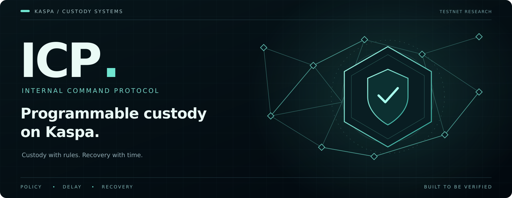
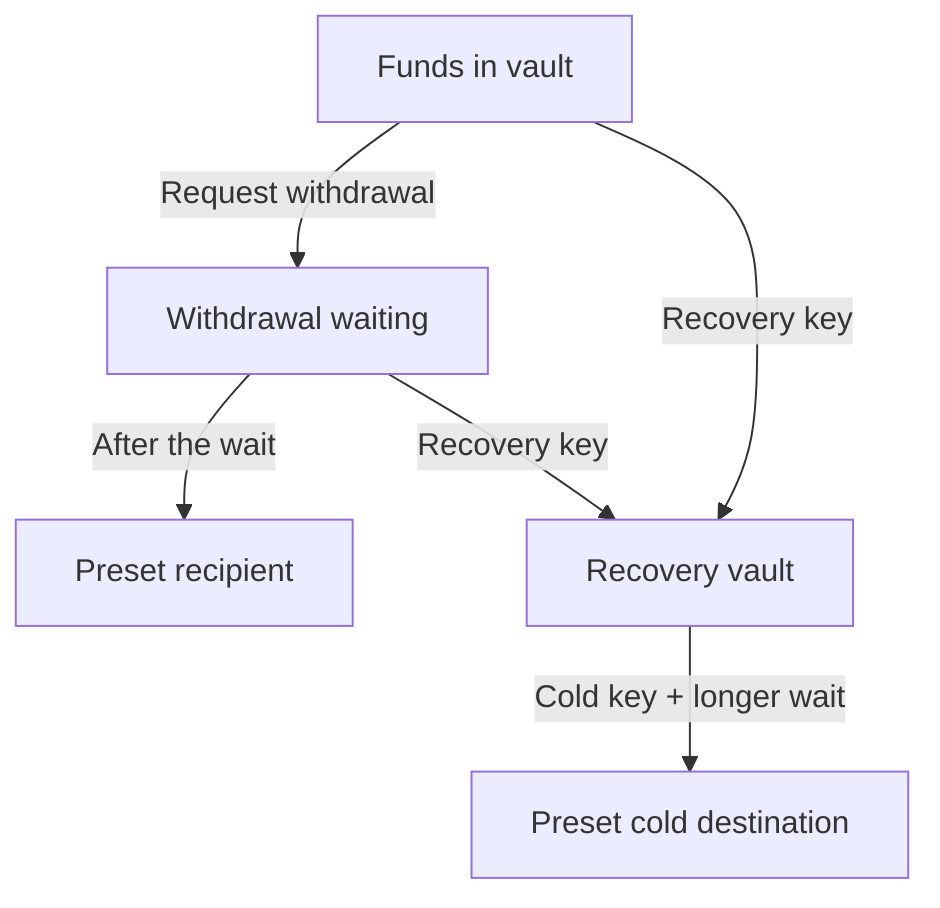

<p align="center">
  
</p>

<p align="center">
  <strong>Rules for withdrawals. Time for recovery.</strong><br>
  Exploring programmable security on Kaspa.
</p>

<p align="center">
  <a href="docs/PLAIN-ENGLISH.md">Start here</a> ·
  <a href="#what-has-been-tested">Test results</a> ·
  <a href="docs/README.md">Documentation</a> ·
  <a href="docs/QUICKSTART.md">Developer setup</a> ·
  <a href="#where-were-going">Roadmap</a>
</p>

---

## What is ICP?

**Internal Command Protocol (ICP) is an experimental vault system built on Kaspa.**
It adds rules to withdrawals: where funds can go, how long a withdrawal must
wait, and which separate key can move funds into recovery.

The idea is simple: **a spending key should still have to follow the rules.**
A waiting period gives monitoring software a chance to notice an unexpected
withdrawal and try to recover the funds before they leave.

**Today:** a Testnet-10 research prototype, tested with test coins. Independent
security review and production operation remain ahead.

## How it works

1. **Set the rules.** Configure the permitted destinations, separate keys and
   waiting periods for a vault.
2. **Watch withdrawals.** A withdrawal enters a waiting period. A monitor checks
   it against saved approvals.
3. **Use recovery when needed.** A separate recovery key can move funds into a
   recovery vault. Releasing them then requires a cold key and a longer wait.



This is the current protected-v1 flow. The monitor's approvals are stored
outside the blockchain; the vault enforces destinations, keys and delays.
Recovery depends on the monitor, separate keys and timely transaction acceptance.
It is not guaranteed to win a race. After funds reach either final destination,
these vault rules no longer protect their later transfers.

[Read the everyday explanation and examples →](docs/PLAIN-ENGLISH.md)

## What has been tested?

| Area | Current result | Read the evidence |
| --- | --- | --- |
| Vault withdrawals and protected recovery | Tested on Kaspa Testnet-10 with test coins, including rejected early payouts | [Protected recovery run](docs/ICP-Protected-Recovery-Live-Proof.md) |
| Automated recovery monitoring | An earlier testnet run recovered an unapproved withdrawal | [Watchtower run](docs/ICP-Watchtower-Live-Proof.md) |
| Recording a data commitment on Kaspa | One testnet transaction observed through two node endpoints | [Transfer anchor run](docs/ICP-Transfer-Anchor-Live-Proof.md) |
| A message encrypted for one recipient | Local HPKE encryption, delivery-key possession checks, sender approval and signed receipts; no network delivery | [Recipient-encryption lab](docs/RECIPIENT-ENCRYPTION-LAB.md) |
| Delivery-key checks and signed response records | Encrypted enrollment challenge plus exact saved signatures over dummy responses; no real key delivery | [Bound response lab](docs/BOUND-RESPONSE-LAB.md) |
| P0 native submission adapter | TN10-only sender checks exact saved records, node/input metadata and deadlines; tested offline, funded P0 acceptance pending | [Live adapter](docs/TICKET-PILOT-LIVE.md) |
| P0 live read path | One native connection reads both roles and history; two live nodes passed exact funding-source eligibility | [Read path](docs/TICKET-PILOT-READ-PATH.md) |
| P0 test-key setup | Six independent keys, possession checks and exact backup restoration for separate consume/refund runs | [Key setup](docs/TICKET-PILOT-KEYS.md) |
| P0 submission recovery | Durable attempts before simulated sends; timeouts/crashes reconcile without retry, with revocable two-node observations | [Submission journal](docs/TICKET-PILOT-SUBMISSION.md) |
| Observation-gated P0 preparation | Fresh two-node entries gate new signing while permanent branch/outbox history survives recovery; synthetic evidence | [P0 binding](docs/TICKET-PILOT-BINDING.md) |
| P0 observation | Exact funding/ticket entries and native transaction fields through two configured node views; synthetic tests, read-only CLI | [P0 observer](docs/TICKET-PILOT-OBSERVER.md) |
| Private P0 preparation | Offline signing with supplied keys, permanent local branch/source claims and exact saved-outbox recovery; no node or submission | [Private preparation](docs/TICKET-PILOT-PRIVATE.md) |
| Fresh-key pilot preparation | Unsigned P0 native previews from public keys and an exact asserted source; no signing or funding authorization | [Pilot preparation](docs/TICKET-PILOT-PREPARATION.md) |
| Native ticket transactions | Offline issue/consume/refund examples signed and checked in Kaspa's script engine; fabricated inputs | [Native ticket lab](docs/NATIVE-TICKET-LAB.md) |
| Native ticket observation | Read-only native ID/layout verification, exact UTXO matching and reversible chain history; synthetic test evidence | [Ticket observer](docs/NATIVE-TICKET-OBSERVER.md) |
| Connected ticket recovery | Current observer facts gate fixture choices/signing; reorgs preserve permanent service history | [Observer/controller integration](docs/NATIVE-TICKET-BINDING.md) |
| Native transaction recovery | Persistent fixture branch choice and exact saved transactions through restart/crashes; synthetic submission only | [Ticket controller](docs/NATIVE-TICKET-CONTROLLER.md) |
| Signed release requests | Exact two-role permissions, recipient challenges and signed revocations over dummy deliveries | [Signed coordinator lab](docs/SIGNED-COORDINATOR-LAB.md) |
| Coordinated release recovery | Synthetic vault/ledger/delivery failures, stale-writer fencing and backup continuity; no real keys | [Coordinator model](docs/RELEASE-COORDINATOR-MODEL.md) |
| Encrypted messages and release accounting | Local experiments; the release model uses simulated chain data and a non-secret placeholder | [Transfer lab](docs/TRANSFER-LAB.md) · [Release model](docs/RELEASE-LEDGER-MODEL.md) |

The automated suite contains **833 tests: 140 Rust + 693 Python**.
[GitHub Actions](.github/workflows/verify.yml) checks the build, tests and demos.
Individual testnet runs are dated evidence, not performance or security
guarantees; later software changes also have their own offline checks.

## The bigger direction: controlled access to encrypted data

Alongside vaults, ICP is researching how a service could check permission before
releasing a key to an encrypted record. Kaspa could record commitments and
transactions; the service would manage private storage, permission checks and
key delivery.

The [recipient-encryption lab](docs/RECIPIENT-ENCRYPTION-LAB.md) now demonstrates
real encryption of a fictional message to one verified delivery key. It checks
separate sender/approver signatures and a recipient acknowledgment. This is a
local cryptographic experiment; a remote release service is still future work.

The local release model already tests duplicate requests, release limits,
crashes and blockchain reorganizations. It delivers **no real decryption keys**.
A person who eventually receives a real key can still read or copy the data;
one authorized release does not mean only one viewing.

[Read the proposal](docs/READ-TICKET-RELEASE-DRAFT.md) ·
[Release-service design](docs/RELEASE-SERVICE-DESIGN.md) ·
[Native ticket design](docs/NATIVE-TICKET-DESIGN.md) ·
[Understand the current limits](docs/SECURITY-TARGET.md)

The new [coordinator simulation](docs/RELEASE-COORDINATOR-MODEL.md) now tests
vault, ledger and delivery failures together. A separate fake authority fences
old writers and detects component backups restored behind its checkpoints.
The [signed coordinator lab](docs/SIGNED-COORDINATOR-LAB.md) now adds two-role
permissions, recipient-signed challenges and signed revocations to that recovery
flow. The new [bound response lab](docs/BOUND-RESPONSE-LAB.md) also checks
recipient encryption-key possession and saves a signature with each exact dummy
response. Responses remain non-secret; record/chain facts remain fixtures.
Real-key delivery and production enforcement need separate review.

The [native ticket lab](docs/NATIVE-TICKET-LAB.md) now builds and checks that
proposal's transaction layouts with fabricated inputs and known test keys.
It demonstrates valid native signatures and detects altered transactions.
The standalone lab has no durable branch controller or real authorization.

The [fixture controller](docs/NATIVE-TICKET-CONTROLLER.md) now adds permanent
branch choice and saved-transaction recovery. Unknown synthetic outcomes are
reconciled without a second attempt. Actual authorization, independent signer
enforcement and live acceptance remain ahead.

The separate [ticket observer](docs/NATIVE-TICKET-OBSERVER.md) can read TN10
chain changes without signing. Offline tests check native transaction bodies,
exact ticket outputs and reorganizations. The [connected fixture controller](docs/NATIVE-TICKET-BINDING.md)
now checks those observations before new work while preserving permanent history.
The connection uses synthetic scans; real authorization and key delivery remain ahead.

The separate [pilot-review tool](docs/TICKET-PILOT-PREPARATION.md) now previews
native transactions using public operator inputs. Its P0 profile is unsigned:
no keys are generated, source observed, transaction signed or funding authorized.
The new [private preparer](docs/TICKET-PILOT-PRIVATE.md) can sign those layouts
with supplied role keys and recover the exact saved transaction after restart.
Interrupted signing stops for reconciliation. The new [P0 observer](docs/TICKET-PILOT-OBSERVER.md)
checks current node-reported entries and transaction fields through a read-only
path. The separate [bound preparer](docs/TICKET-PILOT-BINDING.md) now requires
these fresh observations for new signing. Its tests use simulated node pages
and temporary keys. The [submission journal](docs/TICKET-PILOT-SUBMISSION.md)
now records attempts before simulated sends and reconciles uncertain outcomes
without retrying. A distinct [live adapter](docs/TICKET-PILOT-LIVE.md) now adds
TN10 network submission capability with exact native/input/deadline checks.
Its tests are offline; funded P0 acceptance and actual authorization remain ahead.
The [test-key setup helper](docs/TICKET-PILOT-KEYS.md) now prepares independent
consume/refund roles and verifies backup restoration before funding. Two fresh
test-only sessions have passed those checks, with their backup saved privately.
The [public funding record](evidence/ticket-pilot-keys-verification.md) gives
the exact next step; no P0 transaction has been submitted.

## Explore or build

| Your goal | Start here |
| --- | --- |
| Understand the idea without a technical background | [ICP in plain English](docs/PLAIN-ENGLISH.md) |
| Find a guide or specification | [Documentation directory](docs/README.md) |
| Understand how the components fit together | [Architecture](docs/ARCHITECTURE.md) |
| Build and run the tests | [Developer setup](docs/QUICKSTART.md) |
| Check progress or continue development | [Project status](PROJECT-STATUS.md) · [Developer handoff](docs/ICP-Project-Handoff.md) |

For a local encrypted-message demo with fictional data and no wallet, run from
the repository root:

```bash
python3 -m pip install --only-binary=:all: -r requirements-lab.txt
python3 scripts/recipient_lab.py
```

It prints public ciphertext and signed records, with no plaintext or private
keys. It does not contact Kaspa or
move funds. For live testnet instructions, use the developer setup guide.
**Public fixture keys are intentionally known. Never fund fixture addresses.**

## Where we're going

| Priority | Next work |
| --- | --- |
| Private data access | Complete independent funded consume/refund pilots using the repaired live reader before connecting actual authorization/key delivery |
| Reliable operation | Select and validate independent fencing/storage and recovery enforcement; validate separate signer hosts and alerts |
| Stronger custody | Specify key replacement and recovery from the cold stage, then test and independently review the design |
| Longer-term research | Proof systems and broader data-access enforcement, with separate specifications and evidence |

The current prototype uses conventional cryptography and trusted node/service
software. Mainnet readiness, quantum safety and a completed independent audit
have not been established. The [security target](docs/SECURITY-TARGET.md)
explains exactly which protections are implemented and which remain proposals.

## Contribute

Read [AGENTS.md](AGENTS.md) and the relevant specification before making a
change. Include reproducible checks and keep private keys, databases, signed
outboxes and session backups out of Git. Use project-level attribution.

Original implementation: [MIT](LICENSE). Dependencies and source papers retain
their own terms; see [NOTICE.md](NOTICE.md) and [the import record](docs/IMPORT.md).
