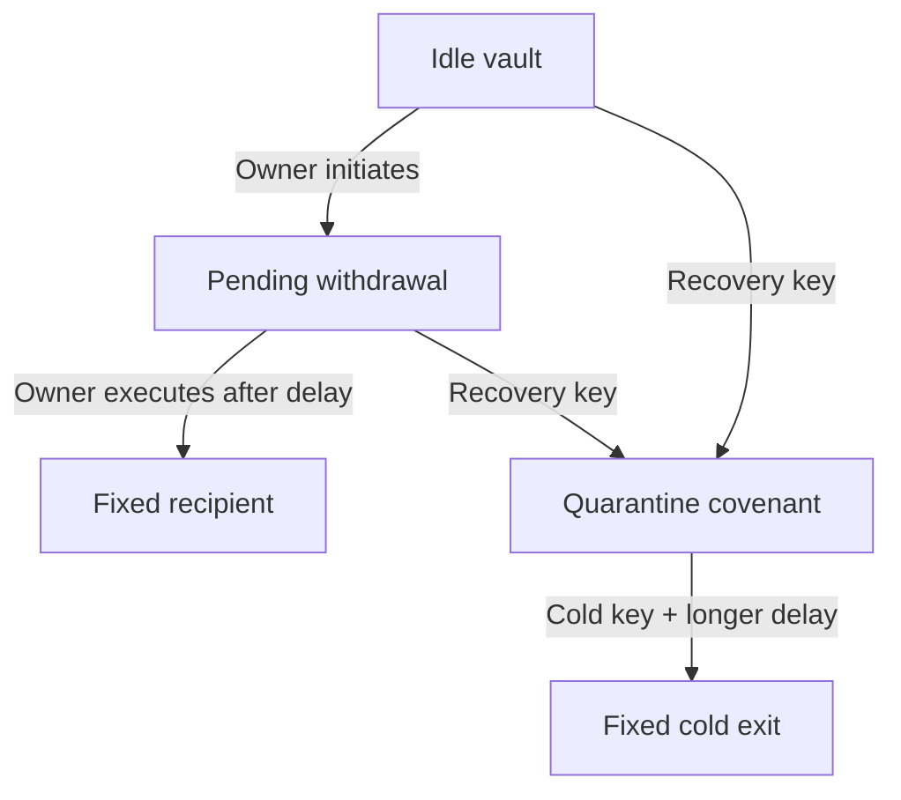

<p align="center">
  
</p>

<p align="center">
  <strong>Custody with rules. Recovery with time.</strong><br>
  A foundation for programmable custody on Kaspa.
</p>

<p align="center">
  <a href="docs/ARCHITECTURE.md">Architecture</a> ·
  <a href="docs/QUICKSTART.md">Quick start</a> ·
  <a href="docs/ICP-Protected-Recovery-Live-Proof.md">Live evidence</a> ·
  <a href=".github/workflows/verify.yml">Verification</a> ·
  <a href="#roadmap">Roadmap</a>
</p>

---

## Build a recovery window into custody

Internal Command Protocol (ICP) explores a simple idea: **a valid spending
signature should still have to follow the vault's rules.**

A withdrawal first creates a new pending output. Its delay gives a watchtower
time to detect an unexpected intent and request recovery. The protected-v1
design routes recovery into another covenant, where a separate cold key and
a fresh, longer delay govern release.

The goal is to make custody policy visible, enforceable and testable on Kaspa:
pinned destinations, explicit authority, bounded fees and time to respond.

The broader direction includes institutional custody and controlled access to
encrypted off-chain data, with Kaspa governing policy and proof verification.
Data tickets, private key delivery and release limits remain research work.
The [security target](docs/SECURITY-TARGET.md) maps this direction and the source
paper to the current implementation and its unresolved design choices.

**Current stage: experimental Testnet-10 prototype.** The v0 vault/watchtower
and protected-v1 lifecycle have passed funded TN10 acceptance runs. The latest
suite passes **141 offline tests: 62 Rust + 79 Python**. Independent
security review and production operation remain ahead.

## The custody lifecycle



This is the protected-v1 contract flow. Watcher approval is an off-chain policy
decision; the covenant enforces the spending paths. The watcher never signs a
cold release. Both recipient and cold exits are P2PK and end covenant protection.
V0's recovery goes directly to its fixed recovery address.

## What is running in code

| Layer | Capability | Validation |
| --- | --- | --- |
| Covenant vaults | Fresh withdrawal delay, fixed destinations, distinct roles, fee/value bounds | Native VM tests + funded TN10 runs |
| Protected recovery | Quarantine covenant, independent cold key, longer release delay | Native VM tests + funded TN10 run |
| Watchtower | Exact-intent approval, accepted-chain observation, durable recovery outbox | Controller tests + earlier funded recovery run |
| Custody tracking | Exact quarantine output through cold release; branch-aware rollback | Offline controller/restart/reorg tests |
| Chain catch-up | Bounded local batches, recovery checks between batches, backlog health | 19 new offline tests |
| Signer deployment kit | Recovery-only SSH endpoint, pinned policy/transport, supervised services | Offline protocol and restart tests; separate-host deployment pending |

Both native CLIs enforce TN10 node identity and activation checks. A broadcast
response never substitutes for an exact accepted-chain output observation.

## Evidence before claims

The latest funded protected-v1 run recorded:

| Observation | Measured result |
| --- | --- |
| Unexpected intent → quarantine | One recovery attempt; 236 DAA units within a 600-DAA withdrawal window |
| Early normal and cold payouts | Both rejected by the node's sequence checks |
| Later payout | The exact same signed transactions accepted after maturity |
| Cold output acceptance | 2,067 DAA units after quarantine; configured delay was 1,800 |
| Independent observation | A second TN10 node observed locked quarantine and final payout outputs |

These are results from one journaled run, not latency or recovery guarantees.
The new catch-up and quarantine-tracking changes have offline verification;
they have not been through a new funded run.

- [Protected-v1 proof and transaction IDs](docs/ICP-Protected-Recovery-Live-Proof.md)
- [Watchtower live proof](docs/ICP-Watchtower-Live-Proof.md) · [Original vault proof](docs/ICP-Testnet-Live-Proof.md)
- [Catch-up verification](evidence/chain-batching-verification.md) · [Quarantine verification](evidence/quarantine-verification.md) · [Signer verification](evidence/signer-verification.md)

## Build and verify

Use Linux x86_64, Python 3, a C compiler and the pinned Rust **1.99.1** toolchain.
From the repository root:

```bash
python3 scripts/compile.py
python3 scripts/compile_protected.py --fixtures
cargo fmt --check
cargo test --locked --features live
python3 -m unittest discover -s tests -p 'test_*.py' -v
cargo build --locked --features live
```

Compiler downloads are checksum verified; Kaspa/Silverscript Git dependencies
are commit-pinned and Cargo is locked. See [TOOLCHAIN.json](TOOLCHAIN.json).
[GitHub Actions](.github/workflows/verify.yml) runs without live keys or RPC.
**Public fixture keys are intentionally known. Never fund fixture addresses.**

For fresh test keys, node setup and a journaled TN10 pilot, follow the
[quick start](docs/QUICKSTART.md). For protected-v1 roles and policy, read
[protected recovery](docs/PROTECTED-RECOVERY.md) before signing.

## Explore the project

| Start here | Purpose |
| --- | --- |
| [Architecture](docs/ARCHITECTURE.md) | Contracts, watcher, signer and trust boundaries |
| [Security target](docs/SECURITY-TARGET.md) | Compromise matrix, paper mapping and tested payout boundaries |
| [Project status](PROJECT-STATUS.md) | Current engineering checkpoint |
| [Vault specification](docs/VAULT-SPEC.md) | V0 invariants and threat model |
| [Protected recovery](docs/PROTECTED-RECOVERY.md) | V1 state transitions and role-specific CLI |
| [Watchtower](docs/WATCHTOWER.md) | Approval, rollback, catch-up and upgrade rules |
| [Signer deployment](docs/SIGNER-DEPLOYMENT.md) | Recovery-only SSH and service supervision |
| [Continuation checkpoint](docs/ICP-Project-Handoff.md) | Remaining work and operational context |

Source lives in `contracts/`, `src/` and `scripts/`; verification lives in
`tests/` and `evidence/`; service templates live in `deploy/`.

## Roadmap

| Horizon | Work |
| --- | --- |
| Now | Reproducible covenant vaults, protected recovery, durable watchtower, quarantine tracking and bounded local catch-up |
| Next | Settle surviving authority, continued cold custody and rotation rules; validate operational failures and independent hosting on TN10 |
| Harden | Cold-stage rescue and rotation specification, pruning/deep-reorg reconciliation, retention, fee estimation and adversarial review |
| Research | Data-release tickets, proof systems, DAG Zippers and STATIC; separately specified before implementation |

The direction is ambitious. Each milestone must earn its claims with code,
tests and inspectable evidence.

## Security boundary

This prototype uses conventional Schnorr keys and an operator-trusted, synced,
UTXO-indexed TN10 node. A separately secure recovery key, watcher availability,
adequate fees and timely inclusion are assumptions. At maturity, recovery has
no guaranteed priority over a competing execution. DAA delays are not wall-clock
guarantees. Local batching does not cap RPC response size or promise a response
SLA. The signer kit has not been installed on independently controlled hosts.

There is no mainnet-readiness, quantum-safety or completed-audit claim. Keep
private keys, databases and signed outboxes out of Git. Reconcile saved
transaction IDs and live outputs before retrying an interrupted pilot.

## Contribute

Read [AGENTS.md](AGENTS.md), the [current checkpoint](PROJECT-STATUS.md) and the
relevant custody specification first. Open an issue or pull request with a
concrete change, reproducible checks and its security implications. Use
project-level attribution and include no private session data.

Original implementation: [MIT](LICENSE). Dependencies and source papers retain
their own terms; see [NOTICE.md](NOTICE.md) and the [import record](docs/IMPORT.md).
