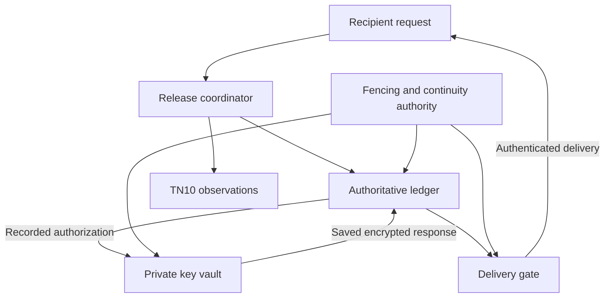

# Release service: key ownership, delivery and recovery

[Plain-English introduction](PLAIN-ENGLISH.md) · [Documentation](README.md) · [R0 draft](READ-TICKET-RELEASE-DRAFT.md)

**Status: proposed service design, not an implemented or independently reviewed
release service.** This extends the R0 draft's implementation gates. It enables
no remote endpoint, real-key connection to simulated grants or funded ticket.
Current code includes the [local recipient-encryption lab](RECIPIENT-ENCRYPTION-LAB.md),
[synthetic release ledger](RELEASE-LEDGER-MODEL.md) and a separate
[synthetic coordinator recovery model](RELEASE-COORDINATOR-MODEL.md). The latter
implements a bounded recovery/fencing simulation with trusted admission and
authentication fixtures; it does not implement this complete service. The
separate [signed coordinator lab](SIGNED-COORDINATOR-LAB.md) now adds conventional
permission, recipient-request and revocation signatures to those boundaries,
while responses, record/chain facts and delivery bindings remain synthetic.

## In plain English

The service would hold the key to an encrypted record. It would check the exact
permission and recipient, save one authorized delivery, and only then send that
key encrypted for the recipient. A retry would recover the same saved delivery.
A restart or restored backup must never become permission to create another one.

This protects a service-controlled release boundary. The original data owner
already knows the information. The key store and service remain trusted, and a
recipient who obtains a key can keep or copy the data. An acknowledgment remains
a signed claim. Neither factual truth nor quantum safety is established.

## 1. Components and authority

| Component or role | Proposed permission | Boundary |
| --- | --- | --- |
| Owner / ingestion process | Submit an immutable record version to the private encryption boundary | Already knows plaintext; can disclose it independently |
| Policy approver + sender | Independently approve the exact grant, record and delivery binding | Both signatures required; neither proves legitimate human intent |
| Recipient identity + delivery key | Authenticate a request and prove possession of the separately registered delivery key | A key binding does not establish a person's real-world identity |
| Release coordinator | Validate rules, reserve grants and reconcile exact saved operations | Cannot export a raw content key or bypass the delivery gate |
| Authoritative ledger | Preserve claims, budgets, outboxes, responses, revocations and disclosure history | Requires a fenced writer and independently checked continuity |
| Private key vault | Encrypt records and prepare one context-bound encrypted key response per grant | Owns content keys and private handles; compromise can expose records |
| Delivery gate | Authenticate retrieval and dispatch only committed, currently eligible responses | Sole permitted response-egress path; cannot create or rewrap a key |
| Ticket controller + TN10 observers | Sign exact issue/consume plans; report current acceptance | Separate native spending authority; trusted observations, not consensus proof |
| Revocation authority | Permanently block specified grants, records, delivery epochs or policies | Cannot authorize a release, erase a used grant or refund a charge |
| Recovery administration | Authorize a reviewed recovery or policy/key-management change | Separate from routine release; required signoffs remain a deployment gate |

The service signing key is separate from content, recipient and ticket keys.
Its signing function belongs inside the protected response-preparation boundary;
it must not expose a general-purpose signing endpoint. No HSM, key-management
provider, host separation or administrative quorum is selected or demonstrated.

These are trust and ownership boundaries. Drawing separate boxes does not
demonstrate process isolation or an implementation of distributed atomicity.

## 2. Record keys stay behind the release boundary

Each record version receives a fresh content key inside the private vault.
The proposed shape is symmetric record encryption plus recipient-specific
encryption of that content key at release. AES-256-GCM and HPKE are candidates
for a later local evaluation; this document does not adopt an R0 suite or wire
encoding. The existing HPKE lab directly encrypts an entire message to the
recipient and therefore cannot serve unchanged as a delayed-release record.

The ingestion operation must reserve an opaque record ID/version and operation
ID before creating material. The vault durably associates the fresh key with
that immutable version; an immutable ciphertext object and authenticated
encryption context are then checked before the ledger marks the record ready.
Lost ingestion replies reconcile the same operation, key handle and ciphertext
digest. Orphaned objects are not relabeled or silently replaced with a new key.

| Stored material | Permitted location |
| --- | --- |
| Plaintext | Owner and private ingestion memory; recipient after authorized decryption |
| Raw content key | Private vault only; no coordinator, status, log or client export API |
| Persistent content-key material | Protected vault storage under a separately managed wrapping key, or an appropriate hardware-backed equivalent; provider/recovery design still required |
| Private key handle and ingestion journal | Restricted service/vault metadata; never a public transaction field |
| Encrypted record and public encryption context | Immutable object storage; access and metadata policy still apply |
| Pending encrypted key response | Private vault response outbox until ledger authorization is committed |
| Committed response and attestation | Restricted immutable ledger/outbox storage; dispatch still requires current gates |

A response encrypted for a recipient is itself a disclosure capability: that
recipient could decrypt it if it leaked. Candidate responses therefore stay
inside the trusted boundary until the required commit and delivery checks.
Debugging, administrative reads and errors must not expose pending response bytes.
No ciphertext, private handle, response or plaintext is automatically published
to Kaspa. Public commitment contents require a separate metadata review.

## 3. One grant, one saved response

The R0 draft's exact issue/consume bindings, dual approval, recipient challenge,
fixed reservation window and two fresh TN10 observations remain required.
Neither a dated anchor nor a fake-chain observation can satisfy those gates.

The stable response-operation identity is `(service_id, budget_id, grant_id)`.
Policy epoch, writer generation and context digest are checked attributes;
they must not create additional operation identities for the same grant.
The bound context includes the immutable record/ciphertext, original approved
intent and recipient request, delivery suite/key/certificate/epoch, exact ticket
and consumption IDs, policy/service identities, budget window and deadlines.
Conflicting context for an existing operation causes a halt, not a replacement.

1. **Reserve.** Atomically claim grant, ticket and challenge, charge the original
   ciphertext bytes/count, and persist the exact consumption outbox. Obtain the
   independent continuity acknowledgment required below before external effects.
2. **Consume and observe.** Persist submission intent before one submission
   attempt. Unknown outcomes are read-only reconciliation of that transaction.
   Require exact current issuance/consumption evidence, successors and freshness.
3. **Authorize preparation.** Recheck recipient binding, policy/revocation,
   original request/grant/window deadlines, clock and current writer generation.
   Persist a response-preparation authorization with its exact context digest.
   The vault validates that authorization and its continuity acknowledgment.
4. **Prepare privately.** The vault creates the encrypted content-key response
   and service attestation. Its own durable outbox enforces uniqueness under the
   stable operation identity and obtains the candidate's continuity acknowledgment
   before returning it internally. A lost
   reply recovers those exact bytes. A crash before any candidate commit may
   repeat internal computation, but must expose no candidate bytes externally.
5. **Commit.** Recheck current gates and atomically store the complete exact
   response/attestation, digest, permanent used-grant record and conservative
   possible-disclosure flag. Confirm the matching independent checkpoint before
   authorizing any delivery. A delayed submission reply cannot regress this state.
6. **Dispatch.** Authenticate a fresh retrieval challenge bound to the original
   request and committed response digest. The delivery gate rechecks eligibility
   and consumes a one-use dispatch authorization. Only the committed bytes may
   leave. No retry rewraps a key, charges another grant or extends a deadline.

Preparation, response commit and dispatch each validate current generation,
policy/revocation state and deadlines at their enforcing boundary. A previously
issued preparation authorization is not a reusable offline bearer capability.

The vault outbox and authoritative ledger do not share an assumed atomic
transaction. If a vault candidate exists without a ledger response, recovery
may commit that same candidate only when its original authorization/context
and all current gates still hold. Otherwise retain it privately and block.
An absent or conflicting vault record after a ledger response commit is an
integrity failure. Do not recreate the response from the raw key.

The complete response contains the selected delivery encoding and authenticated
context, plus a service signature binding their exact bytes/digests. Exact
domains, schemas, bounds, timestamp encoding and signature bytes remain a wire
review gate. Existing lab/model encodings and signatures are not adopted here.

## 4. Dispatch, revocation and rotation

Revocations are purpose-bound, signed, scoped and permanently sequenced in the
authoritative ledger. A revocation request is effective when its durable record
and required continuity acknowledgment are accepted; merely receiving a network
request is not a completed revocation. Repeating the same revocation is
idempotent. A stale sequence or conflicting payload fails closed.

Ledger response commits, accepted revocations and dispatch authorizations must
have a defined serialization order. A dispatch authorization binds its nonce,
grant, original response digest, recipient/request, policy/delivery epochs,
revocation sequence, writer generation and deadline. The delivery boundary
validates and consumes it against current authoritative state; a cached bearer
token or an earlier eligibility result is insufficient.

| Event | Required behavior |
| --- | --- |
| Revocation before response commit | No response commit or delivery; preserve claims, outboxes and quota |
| Revocation after commit | Preserve exact response/used/disclosure history; block new dispatch authorization |
| Expiry or original budget-window end | Stop commit/dispatch; do not move the charge to a later window |
| Reorg before commit | Retain claims/quota and reconcile the same consumption within original deadlines |
| Reorg after commit | Block dispatch, retain possible disclosure; same response may resume only under the draft's original gates |
| Recipient delivery-key change | No rewrapping an old grant to a new key; a new grant needs fresh approvals and its own quota charge |
| Service identity or policy change | Reviewed, separately authorized migration retaining stable claims/budget history; old grants stop unless explicitly compatible under reviewed rules |
| Internal vault wrapping-key rotation | Preserve content keys, record handles, ciphertexts and grant history; re-protect stored keys only through an authorized, journaled operation |

The default for unresolved rotation/compatibility is to stop. A compromised old
key cannot be the sole authorization for replacing itself. Recovery or a new
policy ID must not rename a service/budget to discard accounting. Administrative
key replacement procedures and required independent signoffs must be selected
and tested before enabling operational rotation.

There is still a final-observation race. Chain changes or revocation can occur
after the last valid authorization and before bytes arrive. A dispatch already
authorized or in flight is conservatively treated as possibly disclosed; it
cannot be recalled. The target is to reject new dispatch authorization after
an accepted revocation or other observed disqualifying change. Delivered keys
cannot be erased, and exactly-once arrival is not promised.
Recipient receipts do not clear possible disclosure or restore quota.

## 5. Fencing, checkpoints and recovery

A SQLite lock or a lease stored beside a restorable database is not the proposed
anti-rollback boundary. Remote operation requires an independently maintained
authority that controls monotonically increasing writer generations and
continuity checkpoints. No provider or implementation is selected here.

The ledger storage boundary, vault and delivery gate must enforce the active
generation. An obsolete coordinator cannot write, prepare a response or dispatch
a cached response. The ticket-signing/effect path also needs fencing. The
deployment must prevent alternate egress paths from bypassing these checks.
A generation increment cannot retract a packet already in flight.

Critical durable changes receive an ordered sequence and hash-chain checkpoint:
record admission, grant/challenge claims, quota, transaction outboxes, response
preparation/commit, revocations/epochs, consumed retrieval/dispatch nonces and
trusted-clock high-water marks. An independent witness acknowledges the exact
checkpoint idempotently. Its continuity state must not roll back with the
application backup. No public key material or raw response bytes are needed in
the checkpoint; even its metadata requires access controls and review.

Vault candidate commits are included, with component/operation identity,
context/response digests and a link to their authorizing ledger checkpoint.
Recovery must compare each component's journal with the corresponding witnessed
history; a current ledger alone does not establish that a restored vault is current.

No associated external effect or response dispatch occurs before the necessary
checkpoint acknowledgment. If an acknowledgment is lost, query the same
operation/checkpoint. A local journal ahead of the witness does not justify
inventing an acknowledgment; a witness ahead of or conflicting with restored
state does not justify clearing counters. Stop until exact records and prefixes
can be reconciled. The witness and fencing authority are additional trusted
components, not a trustless proof supplied by the current Kaspa anchor.

Recovery proceeds with all effect paths halted:

1. Fence the previous writer at every enforcing component and acquire a new
   generation. If that cannot be established, remain halted.
2. Restore the ledger and private vault state. Verify service/budget identities,
   policy history, journal/checkpoint prefixes, vault operation contexts and
   exact committed response digests. Never start from an empty replacement DB.
3. Reconcile independent continuity acknowledgments and inspect unknown native
   transactions read-only. A pending local acknowledgment is resolved by exact
   identity, not by retrying an effect or creating a new grant.
4. Re-establish trusted clock continuity and current recipient/policy/revocation
   state. Require fresh chain scans; restored observation caches are unusable.
5. Resume only consistent operations still inside their original deadlines.
   Unresolved records remain blocked with their claims and charges intact.

For future wire review, service time is integer UTC Unix seconds and ordering
uses durable sequence numbers. Persist observed clock progress even when a
request is rejected. Backward movement or uncertain continuity halts release;
an abrupt crash cannot preserve a sample never committed. A clock source and
reconciliation policy still need selection and testing.

If a content key is irretrievably lost, its ciphertext is unavailable. A backup
key bypass, automatic refund or newly wrapped substitute cannot repair that
record. Any owner-authorized replacement is a new record version and new grant.
Retention, encrypted backups, restore access and key destruction need a reviewed
operating policy; deletion never recalls keys already disclosed.

## 6. Acceptance cases and the next implementation

| Case | Required observation before remote release can be enabled |
| --- | --- |
| Wrong recipient, certificate, record/version or consumption | No vault preparation, ledger commit or dispatch under mismatched context |
| Raw-key export or pending-response read | Rejected at the boundary; no secret/candidate in logs, status or errors |
| Two workers or a copied application DB | Stale generation rejected by enforcing storage, vault and egress; no second grant/response |
| Crash before/after vault candidate commit | No external response; reconcile an existing candidate exactly when present |
| Crash after vault commit but before ledger commit | Reuse exact candidate only if still eligible; never rewrap after expiry or conflict |
| Crash after ledger commit or lost client reply | Preserve permanent used/disclosure state; authenticated retries recover identical bytes |
| Lost checkpoint acknowledgment | Query the exact checkpoint; no effect until continuity is established |
| Restored snapshot behind/conflicting with witness | Halt rather than reset claims, quota, nonces, clock or revocations |
| Revocation racing preparation/commit/dispatch | Defined durable order; no newly authorized dispatch after accepted revocation |
| Reorg or expiry at every boundary | Block eligibility, preserve history/quota and explicitly account for in-flight disclosure |
| Policy/key rotation or lost content key | No silent grant relabeling, replacement response or counter reset |
| Receipt signed without decryption | Remains a claim; creates no release authorization and refunds nothing |
| Compromised key vault, witness or all accepted authorities | Documented trust-boundary failure; no protection against all-secret compromise is claimed |

The next executable deliverable is a **synthetic-only coordinator recovery
model** with separate fake vault, checkpoint/fencing authority and delivery gate.
Its inputs and responses remain non-secret placeholders with no network or native
signer. Test the cross-store crash, stale-writer, restore, checkpoint-loss and
revocation races above before adding real encryption to that boundary.

Separate gates remain: independent application/security review; a frozen
delivery/wire protocol and recipient directory; a protected key-store and
anti-rollback/fencing implementation; authenticated transport, resource limits
and metadata review; native issue/consume/refund rules and fresh TN10 acceptance.
These design requirements are not completed implementations or permission to
deploy a remote release service.
